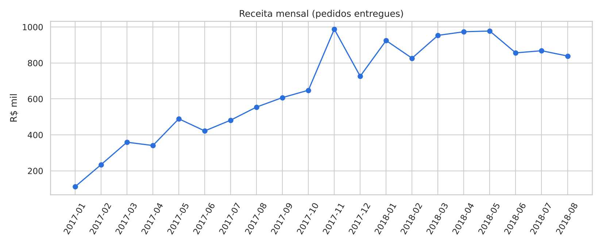
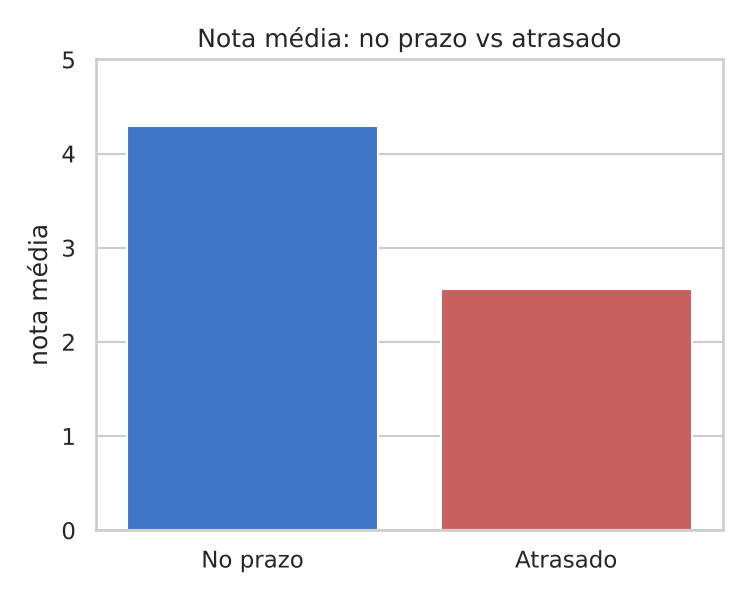

# Análise de E-commerce (Olist) com Python

Projeto de análise de dados do início ao fim sobre o dataset público de e-commerce da Olist (~100 mil pedidos, 2016–2018), usando **Python, pandas, matplotlib e seaborn**.

## Perguntas respondidas
- Como evoluiu a receita ao longo do tempo?
- Quais categorias e estados mais vendem?
- Quanto tempo leva a entrega e quantos pedidos atrasam?
- O atraso afeta a nota dos clientes?
- Como os clientes pagam e quantos voltam a comprar?

## Principais resultados
| Indicador | Resultado |
|---|---|
| Crescimento da receita (média mensal jan–ago/2018 vs 2017) | +141% |
| Participação de SP na receita | 38,3% |
| Prazo médio de entrega | 12 dias (SP ~8 dias; PA e AM > 23 dias) |
| Pedidos entregues com atraso | 8,1% |
| Nota média: no prazo vs atrasado | 4,29 vs 2,57 |
| Pedidos pagos com cartão de crédito | 75% |
| Clientes que compraram mais de uma vez | 3,0% |




## Como rodar
```bash
pip install pandas matplotlib seaborn jupyter
cd E_Commerce
jupyter notebook analise.ipynb
```
Os CSVs ficam em `E_Commerce/CSV/` (dataset [Brazilian E-Commerce Public Dataset by Olist](https://www.kaggle.com/datasets/olistbr/brazilian-ecommerce)).

## Estrutura
- `E_Commerce/analise.ipynb`: análise completa (carga, limpeza, junção das tabelas, gráficos e conclusões)
- `E_Commerce/imagens/`: gráficos exportados
- `E_Commerce/CSV/`: dados brutos

## Limitações
Receita considera só o preço dos itens (sem frete) e apenas pedidos entregues; meses de borda da base têm poucos pedidos e ficam fora do gráfico mensal.
